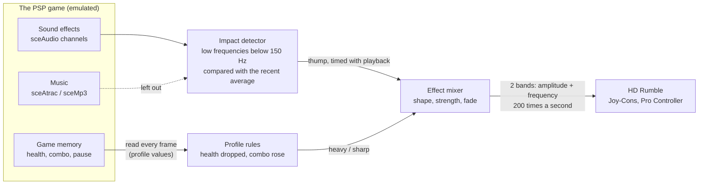

# PPSSPP-rm: HD Rumble for PSP games on the Nintendo Switch

**ppsspp-rm** is [NaGaa95's PPSSPP-nx](https://github.com/NaGaa95/ppsspp-nx) (the Switch port of [PPSSPP](https://github.com/hrydgard/ppsspp)) with **HD Rumble** added. The PSP has no vibration motor, so no PSP game ever asks for rumble. This build works it out from what the game plays and what happens in it.

> ### ▶ [Try the interactive explainer](https://jvankooo.github.io/ppsspp-rm/)
> Drag the sensitivity and strength sliders and watch which sounds turn into rumble, see each kind of rumble's shape and the two HD Rumble bands it drives, and play a God of War fight to see which hits make the Joy-Cons rumble and how hard.

It's a fork so it can keep up with NaGaa95's work: every performance fix and new feature in PPSSPP-nx can be merged in (see [Keeping up with PPSSPP-nx](#keeping-up-with-ppsspp-nx)).

**Supported game so far:** God of War: Chains of Olympus (USA, `UCUS98653`). Any game can get rumble with a [profile](#profiles-which-games-rumble).

---

## How it works



There are two sources of rumble, mixed together:

<details open>
<summary><b>1. Sound: impacts you hear</b></summary>

PPSSPP mixes the game's audio itself, so the emulator hears every sample before the speakers do.

- **Only the low end counts.** The mix goes through two low-pass filters at about 150 Hz. What's left is the body of an explosion, a door slamming, a heavy landing; speech, music and high effects mostly drop out.
- **It looks for a sudden jump, not a loud level.** Every 10 ms the low end is compared with its own average over the last ~200 ms. A burst has to be well above that average (2.5× at the default sensitivity) *and* above a small minimum. A steady drone or engine raises the average with it, so it doesn't keep rumbling.
- **Music is left out.** A sceAudio channel that plays what sceAtrac or sceMp3 decoded counts as music, so a bass line doesn't shake the controller.
- **It's timed with the speakers.** Each detected burst waits until its samples are actually playing, so the rumble lands with the sound instead of ahead of it.
- **Sensitivity 1-10 (default 5)** moves both thresholds: each step changes them by a factor of 2^(1/2.5), so 10 catches small bumps and 1 only the biggest booms. 0 turns sound rumble off.

A detected burst becomes a short **thump**: 60 ms, decaying quickly.
</details>

<details open>
<summary><b>2. Game state: what happens to you</b></summary>

For a game with a profile, the emulator reads a few values from the game's memory once per frame (Kratos's health, the combo counter, whether the game is paused) and turns their changes into rumble:

| What happened | Rule | Feels like |
|---|---|---|
| Kratos's health dropped | `hit_taken`: stronger and longer for a bigger part of the health bar; above a quarter of it, a full 450 ms blow | **heavy** |
| The combo counter went up | `hit_landed`: a crisp 70 ms tap for each blow that lands | **sharp** |
| Paused, dead, or a movie playing | `active_when`, `mute_during_video` | nothing |

Values are found through pointer paths (`* +0x84 * +0x24 * find(...)`), so they keep working across levels and respawns, when the game moves the objects around.
</details>

<details>
<summary><b>3. HD Rumble: what the Joy-Cons get</b></summary>

An HD Rumble motor isn't on/off: it plays two bands at once, a low one and a high one, each with its own **frequency** and **amplitude**. Every effect has a *feel* that sets both bands and how it fades:

| Feel | Low band | High band | Shape | Used for |
|---|---|---|---|---|
| heavy | 130 Hz, full | 260 Hz, 55% | holds for the first 30%, then fades | hits taken, crashes |
| sharp | 180 Hz, 45% | 340 Hz, full | straight fade to nothing | blows landed |
| thump | 160 Hz, full | 320 Hz, 60% | drops to 60% every 10 ms | sound impacts |
| soft | 140 Hz, 80% | 280 Hz, 40% | holds half, then fades | gentle cues |
| engine | 85 Hz, full | 190 Hz, 30% | continuous, follows a value | speed (racing games) |
| buzz | 220 Hz, 50% | 440 Hz, 90% | continuous, follows a value | rough ground |

When effects overlap, each band takes the strongest one. The result is scaled by the **strength** setting (None 0%, Light 42%, Medium 64%, Strong 84%, Hard 100%), lifted a little so weak effects are still felt, and sent to the controllers 200 times a second: the handheld Joy-Cons and player 1 (Pro Controller, a pair of Joy-Cons, or one).

Nothing is sent while PPSSPP's pause menu is open or another applet (the HOME menu) has the focus.
</details>

---

## Install

1. [Build it](#building), or take `PPSSPP-rumble-sd.zip` from [Releases](https://github.com/jvankooo/ppsspp-rm/releases) once a build is published there.
2. Copy its `switch` folder to the root of the SD card:

   ```
   switch/ppsspp-nx/PPSSPP.nro                   the emulator (replaces PPSSPP-nx's)
   switch/ppsspp-nx/PSP/RUMBLE/UCUS98653.ini     God of War: Chains of Olympus (USA)
   ```

Your settings, saves and games are kept.

## Settings

In a game: pause menu > **Rumble**. Or Settings > Controls > **Rumble**.

| Setting | For | What it does |
|---|---|---|
| Rumble | all games | On / off |
| Rumble strength | all games | None, Light, Medium, Strong (default), Hard |
| Rumble strength for this game | this game | "Use the global setting", or its own |
| Sound rumble sensitivity | this game | Off, 1-10 (default 5). Higher: smaller impacts rumble |
| Hits taken / Blows landed | this game | Each kind of game-state rumble on or off |
| Test buttons | | Feel a heavy hit, a sharp tap and a sound thump |

Per-game settings are kept in `sdmc:/switch/ppsspp-nx/PSP/RUMBLE/settings/`.

## Profiles: which games rumble

Rumble only runs for a game with a profile: `sdmc:/switch/ppsspp-nx/PSP/RUMBLE/<GAME ID>.ini`. No profile, no rumble, so games that would feel wrong are left alone.

<details>
<summary><b>The God of War profile, annotated</b></summary>

```ini
[Profile]
name = God of War: Chains of Olympus
active_when = health > 0, paused == 0   ; only while Kratos is alive and the game runs
sound = on
sound_sensitivity = 5
mute_during_video = on

[Value.health]                           ; Kratos's health: the component with vtable 0x08B3E248
address = 0x08B3655C
path = * +0x84 * +0x24 * find(64, 0x0C, 0x08B3E248) +0x64
type = float

[Rule.hit_taken]
value = health
event = drop                             ; fires when health goes down
relative_to = health_max                 ; the drop as a part of the bar
strength = 0.35                          ; strength = 0.35 + 2.6 x drop, up to 1.0
gain = 2.6
duration = 200
big = 0.25                               ; a quarter of the bar or more: 1.0 for 450 ms
big_strength = 1.0
big_duration = 450
feel = heavy
```

The whole file: [`assets/rumble/UCUS98653.ini`](../assets/rumble/UCUS98653.ini).
</details>

To make a profile for another game, see [`docs/rumble.md`](../docs/rumble.md): the format, value paths, level rules for engines, and how to find the addresses with RAM snapshots (**Save RAM snapshot...** in the Rumble settings) and `Tools/rumble/rumble_research.py`. Keep game content (ISOs, decrypted EBOOTs, RAM dumps) out of the repository.

## Also in this build

- **Graphics backend per game:** launcher > Y (Game menu) > Game settings > Graphics > Rendering backend.
- **SteamGridDB covers and backgrounds**, downloaded separately, with file sizes in the list and a 16:9 crop for backgrounds. HTTPS is checked against the Switch's own trusted certificates. The API key can be put in `sdmc:/switch/ppsspp-nx/steamgriddb_key.txt` instead of typing it.
- A roomier pause menu, and no controller connect / disconnect pop-ups.

## Keeping up with PPSSPP-nx

This repository is a GitHub fork of `NaGaa95/ppsspp-nx`, with two branches:

- **`main`** (the default) is PPSSPP-rm: NaGaa95's work plus rumble.
- **`master`** mirrors NaGaa95's `master`, untouched. Bring it up to date with the **Sync fork** button on GitHub (with `master` selected), or `gh repo sync jvankooo/ppsspp-rm -b master`.

To take NaGaa95's new commits into `main`, open a pull request from `master` into `main` here; GitHub merges it in the browser when nothing conflicts. Otherwise, locally:

```
git remote add upstream https://github.com/NaGaa95/ppsspp-nx.git
git fetch upstream
git checkout main
git merge upstream/master      # fix any conflicts, build, test on the Switch
git push origin main
```

This README lives in `.github/README.md`, so the PPSSPP-nx README at the root is never changed here and never conflicts.

## Building

On Windows with [devkitPro](https://devkitpro.org/) (see `build-rumble.sh` for what it expects):

```
C:\devkitPro\msys2\usr\bin\bash.exe -lc "cd /path/to/ppsspp-rm && bash build-rumble.sh"
```

It produces `dist/PPSSPP.nro`. The rumble code: `Core/Rumble/Rumble.cpp` (profiles, rules, sound detector, effect mixer), `SDL/SwitchRumble.cpp` (HD Rumble output through libnx), and hooks in `Core/HLE/__sceAudio.cpp`, `sceAtrac.cpp`, `sceMp3.cpp`, `sceMpeg.cpp`, `scePsmf.cpp` and `sceDisplay.cpp`.

## Credits

[PPSSPP](https://github.com/hrydgard/ppsspp) by Henrik Rydgård and contributors. The Switch port, launcher and Deko3D renderer: [PPSSPP-nx by NaGaa95](https://github.com/NaGaa95/ppsspp-nx). Licensed under the GPL 2.0 or later, like PPSSPP.
